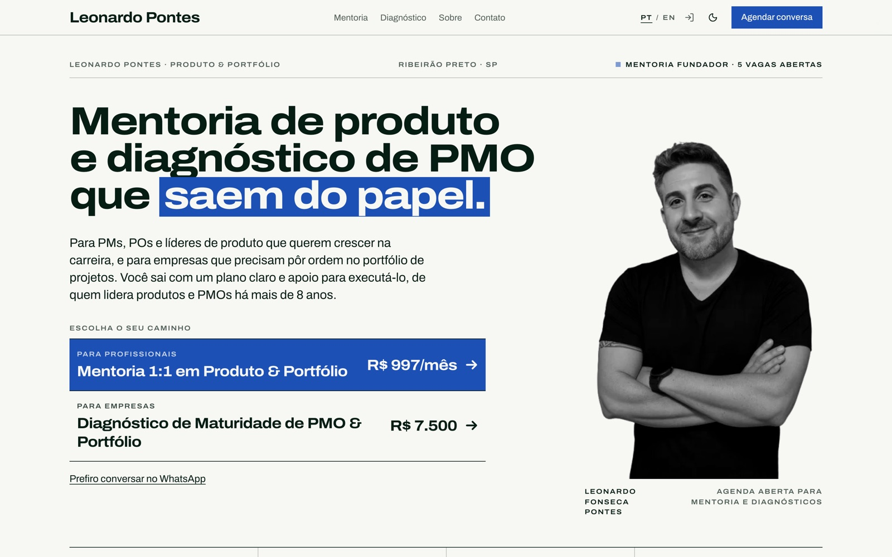
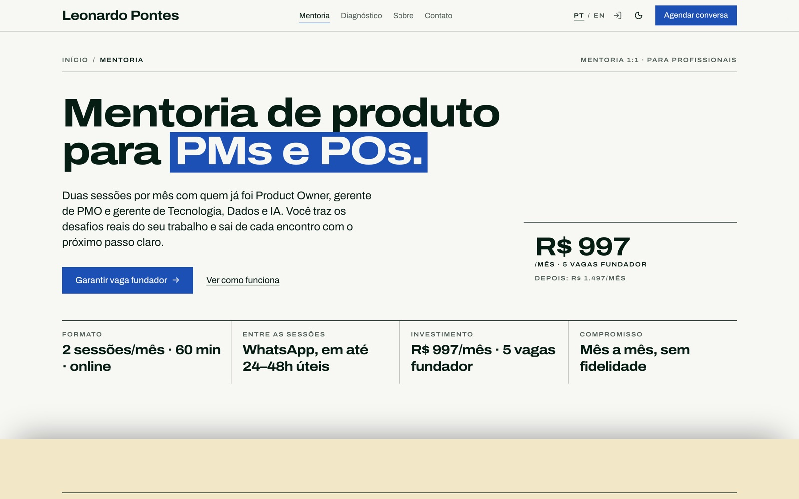
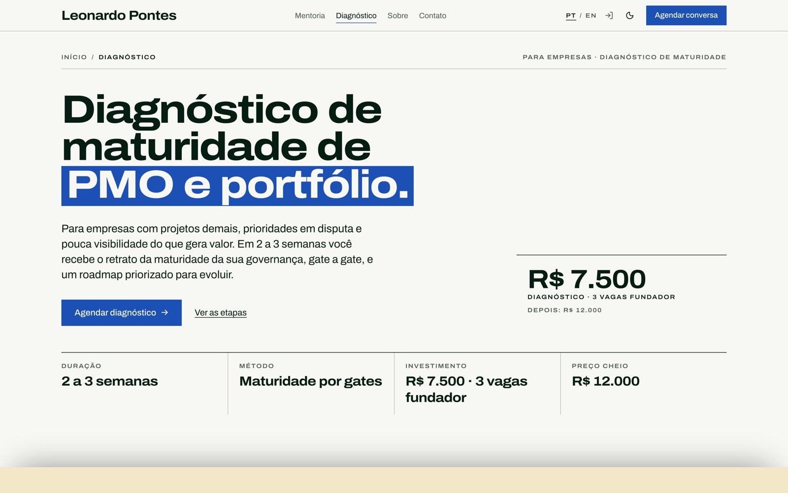
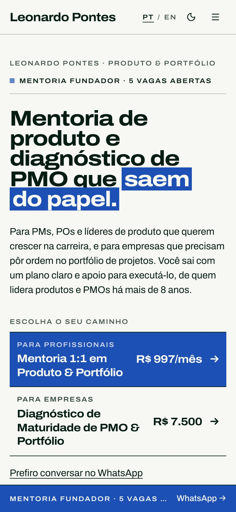
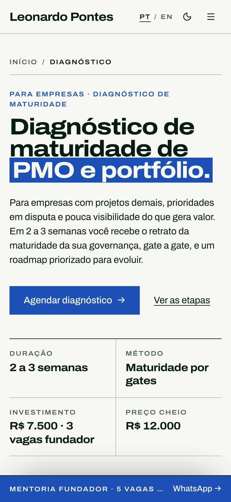
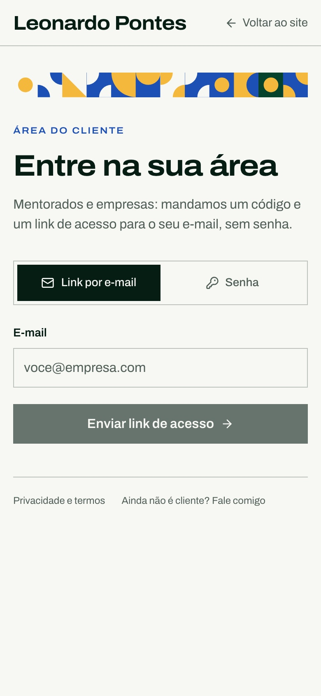
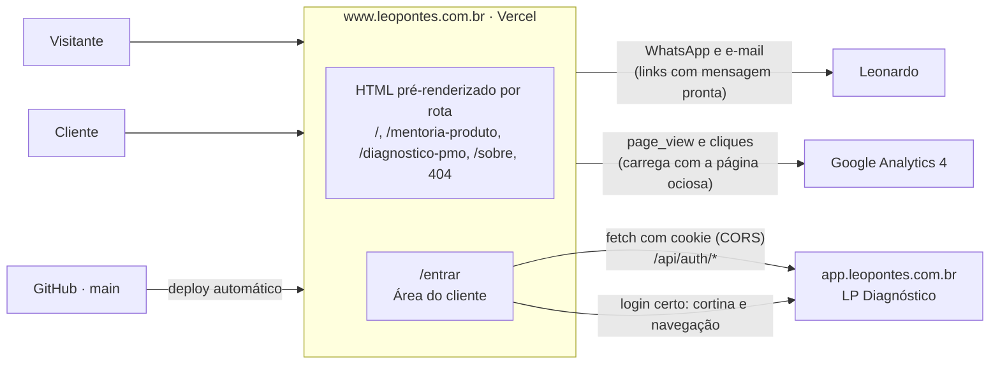

<div align="center">

# Leonardo Pontes · LP | Produto & Portfólio

**Mentoria de produto e diagnóstico de PMO que saem do papel.**

Mentoria 1:1 para PMs, POs e líderes de produto, e diagnóstico de maturidade de PMO e portfólio
para empresas, por quem lidera produtos e PMOs há mais de 8 anos.

[**leopontes.com.br**](https://www.leopontes.com.br) ·
[Área do cliente](https://www.leopontes.com.br/entrar) ·
[LinkedIn](https://www.linkedin.com/in/leonardo-fonseca-pontes-465740103/) ·
[WhatsApp](https://wa.me/5516991091234)



</div>

---

## Sumário

- [O que eu ofereço](#o-que-eu-ofereço)
- [Vitrine](#vitrine)
- [Sobre este repositório](#sobre-este-repositório)
- [Mapa da infraestrutura](#mapa-da-infraestrutura)
- [Stack](#stack)
- [Passo a passo para desenvolvedores](#passo-a-passo-para-desenvolvedores)
- [Documentação](#documentação)

## O que eu ofereço

| | Mentoria 1:1 em Produto & Portfólio | Diagnóstico de Maturidade de PMO & Portfólio |
|---|---|---|
| **Para quem** | PMs, POs, Product Designers, gerentes de projeto e líderes de PMO | Empresas com projetos demais, prioridades em disputa e pouca visibilidade do valor |
| **Como** | 2 sessões de 60 min por mês, online, e WhatsApp entre as sessões | 2 a 3 semanas: entrevistas, maturidade por etapa da metodologia, roadmap priorizado e apresentação executiva |
| **Investimento** | **R$ 997/mês** (5 vagas fundador), depois R$ 1.497/mês; sem fidelidade | **R$ 7.500** (3 vagas fundador), depois R$ 12.000; implementação sob proposta |
| **Página** | [/mentoria-produto](https://www.leopontes.com.br/mentoria-produto) | [/diagnostico-pmo](https://www.leopontes.com.br/diagnostico-pmo) |

Quem já é cliente acompanha tudo pela plataforma
[LP Diagnóstico](https://app.leopontes.com.br), com entrada pela
[Área do cliente](https://www.leopontes.com.br/entrar) do site.

**→ [Agendar uma conversa gratuita de 30 minutos](https://wa.me/5516991091234)**

## Vitrine

| Mentoria de produto | Diagnóstico de PMO |
|---|---|
|  |  |

| Início, no celular | Diagnóstico, no celular | Área do cliente |
|---|---|---|
|  |  |  |

## Sobre este repositório

O site é a vitrine da prática e também uma amostra de como eu trabalho: produto bem definido,
código limpo, testes e documentação.

**Páginas com endereço próprio, navegação sem recarregar.** Cada rota sai do build como um HTML
completo, com título, descrição, Open Graph e dados estruturados próprios, para os buscadores e
para quem compartilha o link. Entre as páginas, um roteador próprio troca o conteúdo sem
recarregar, com View Transitions: o cabeçalho fica parado e a página nova sobe.

| Rota | Conteúdo |
|---|---|
| `/` | As duas ofertas com preço, depoimentos, quem conduz, contato |
| `/mentoria-produto` | Para quem é, o que trabalhamos, preço, como funciona, perguntas frequentes |
| `/diagnostico-pmo` | Etapas (Conversa inicial → Diagnóstico → Plano de ação → Execução acompanhada), entregáveis, preço, perguntas frequentes |
| `/sobre` | História, produtos autorais, trajetória, competências, formação |
| `/entrar` | Área do cliente: entrada na plataforma por código ou link por e-mail (`noindex`) |
| qualquer outra | 404 de verdade (`noindex`) |

**Identidade: LP Noir.** Preto quente, marfim e um único acento champagne; Roboto, com a palavra
de destaque em serifa itálica; cantos de 8 a 12 px; vidro translúcido com luz de borda no que
flutua; rótulos e botões em inglês, conteúdo em português. A arte é um funil de portfólio que
atravessa os gates G1–G4. A plataforma (lp-diagnostico) usa os mesmos tokens
(`src/styles/lp-noir.css`). Cada capítulo da página continua sendo uma **cena** que muda o fundo
enquanto você rola. Quem pede menos movimento vê uma versão suave, sem parallax.

**SEO.** Título e H1 por página mirando as buscas da oferta. O JSON-LD traz `Person`,
`ProfessionalService`, `Service` + `Offer` com os preços reais (lidos do conteúdo), `FAQPage` onde
há perguntas visíveis e `BreadcrumbList`. O `sitemap.xml` é gerado das rotas no build.

## Mapa da infraestrutura



- **Hospedagem**: Vercel, servindo `dist/` com URLs limpas (`/sobre` → `sobre.html`), cache
  imutável em `/assets` e `/fonts`, e cabeçalhos de segurança em [`vercel.json`](vercel.json).
- **DNS**: `leopontes.com.br` no Registro.br; o domínio sem `www` redireciona para o `www`.
- **Área do cliente**: o `/entrar` fala com a API da plataforma (`VITE_APP_URL`, padrão
  `https://app.leopontes.com.br`). O cookie de sessão funciona entre `www` e `app` porque os dois
  são o mesmo site, `leopontes.com.br`. O desenho completo está no repositório da plataforma, em
  `docs/publicacao.md`.

## Stack

| Camada | Escolha |
|---|---|
| Interface | React 19 + TypeScript `strict` |
| Estilo | Tailwind CSS 4 + componentes [shadcn/ui](https://ui.shadcn.com) (Radix) |
| Movimento | GSAP (ScrollTrigger, SplitText) + Lenis; azulejos e arte generativa em canvas, com PRNG determinístico |
| Navegação | Roteador próprio com View Transitions, sem dependência nova; voltar e avançar restauram a rolagem |
| Build | Vite com pré-renderização: `vite build`, `vite build --ssr` e `scripts/prerender.mjs`, que gera um HTML por rota e o sitemap |
| Conteúdo | Modelo tipado, em pt-BR e EN, separado da apresentação |
| Testes | Vitest + Testing Library (100 testes): rotas, HTML de cada página, SEO e JSON-LD, navegação, conteúdo nos dois idiomas |
| Qualidade | Lighthouse 100 em acessibilidade, boas práticas e SEO |
| Deploy | Vercel, ligado ao GitHub |
| Analytics | Google Analytics 4 atrás de uma interface própria (`AnalyticsTracker`) |

**Princípios.** Serviços com uma responsabilidade (`ContactLinkBuilder`, `AnalyticsTracker`),
injetados por contexto; idiomas e seções entram por registro, sem mexer em quem consome; nenhuma
string solta nos componentes; peças-base reaproveitadas (`Scene`, `SplitReveal`,
`useSteppedScene`, `SectionHeader`, `TrackedLink`). Os testes garantem que pt-BR e EN têm a mesma
estrutura e que nenhum cliente confidencial é citado.

## Passo a passo para desenvolvedores

### 1. Preparar

Requisitos: Node 20 ou mais novo (o projeto é desenvolvido no **Node 24**) e npm.

```bash
git clone git@github.com:leonfpontes/perfil_portfolio.git
cd perfil_portfolio
npm install
```

### 2. Rodar

```bash
npm run dev
```

O site abre em http://localhost:3000. Para testar a Área do cliente contra a plataforma rodando
na sua máquina, crie um `.env.local` com `VITE_APP_URL` apontando para ela (por exemplo
`http://localhost:3300`). No servidor da plataforma, a origem do site precisa estar em
`SITE_ORIGINS`.

### 3. Conferir antes de abrir um PR

```bash
npm run typecheck
```

```bash
npm test
```

```bash
npm run build
```

Depois do build, `npm run preview` serve o `dist/` em http://localhost:4173. Confira o HTML cru de
cada rota (título, H1, preços) e o celular a 375 px.

### 4. Publicar

Merge na `main` → a Vercel publica sozinha. Pull requests ganham um preview.

### Scripts

| Script | Para quê |
|---|---|
| `npm run dev` | Servidor de desenvolvimento em :3000 |
| `npm run build` | Tipos, build do cliente e do servidor, pré-renderização e sitemap em `dist/` |
| `npm run preview` | Serve o `dist/` em :4173 |
| `npm test` / `test:watch` / `test:coverage` | Testes |
| `scripts/lh-median.sh <url> [rodadas]` | Mediana de várias rodadas do Lighthouse mobile (uma rodada só oscila muito) |
| `python3 scripts/make-og-image.py` | Gera a imagem de compartilhamento (`public/images/og-image.png`, 1200×630) |

### Onde mexer

| Para mudar | Arquivo |
|---|---|
| Textos, preços, FAQ, depoimentos | `src/content/locales/pt-BR.ts` e `en.ts` (veja [`docs/CONTENT.md`](docs/CONTENT.md)) |
| Contatos, links e identidade | `src/content/profile.ts` |
| Rotas, seções de cada página e âncoras antigas | `src/lib/router/routes.ts` |
| Título, descrição e JSON-LD de cada página | `src/seo/head.ts` |
| Cores, tipografia e tokens | `src/styles/globals.css` (os mesmos tokens da plataforma: mude os dois juntos) |

## Documentação

- [`docs/ARCHITECTURE.md`](docs/ARCHITECTURE.md): páginas, camadas, fluxo de dados e decisões.
- [`docs/CONTENT.md`](docs/CONTENT.md): como editar textos, preços, produtos e idiomas.
- [`docs/DESIGN.md`](docs/DESIGN.md): o sistema visual "modernismo brasileiro".

---

<div align="center">

**Precisa estruturar o portfólio da sua empresa ou acelerar a sua carreira em produto?**

[Fale comigo no WhatsApp](https://wa.me/5516991091234) · [Conecte-se no LinkedIn](https://www.linkedin.com/in/leonardo-fonseca-pontes-465740103/)

<sub>© Leonardo Fonseca Pontes · LP | Produto & Portfólio</sub>

</div>
