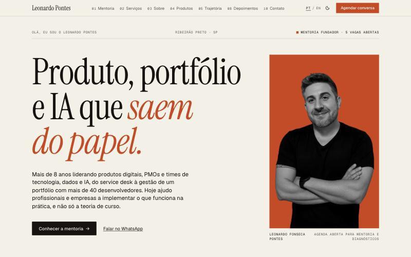

<div align="center">

# Leonardo Pontes

**Produto, portfólio, dados e IA que saem do papel.**

Mentoria 1:1 e consultoria em gestão de produtos digitais, governança de portfólio e PMO
— por quem lidera, constrói e coloca produtos em produção há mais de 8 anos.

[**leopontes.com.br**](https://leopontes.com.br) ·
[LinkedIn](https://www.linkedin.com/in/leonardo-fonseca-pontes-465740103/) ·
[WhatsApp](https://wa.me/5516991091234) ·
[leonfpontes@gmail.com](mailto:leonfpontes@gmail.com)



</div>

---

## Em 30 segundos

| | |
|---|---|
| **Hoje** | Product Designer · Produto, Dados & IA na **ATRA**, uma consultoria de dados e IA com mais de 15 anos de mercado. Fundador da **LP \| Produto & Portfólio**. |
| **Antes** | Gerente de Tecnologia, Dados & IA e de PMO na **Educacross** · Gerente de Projetos e Operações de um portfólio com **mais de 40 devs** na **Digi.ai** · Product Owner de 4 produtos na **Conexia Educação** |
| **Formação** | MBA em Gestão de Projetos (**USP**) · Ciência da Computação · trilha Google Cloud *Professional ML Engineer* |
| **Produtos próprios** | **GiraHub** (SaaS multi-tenant em produção) · **LP Diagnóstico** · **Portal PMO** (2023–2026) · **PlantMap** |
| **Base** | Ribeirão Preto, SP · remoto ou híbrido em São Paulo · português e inglês |

## O que eu ofereço

### Mentoria 1:1 em Produto & Portfólio · *R$ 997/mês (preço fundador)*
Para POs, PMs, Product Designers, gerentes de projeto e líderes de PMO que querem evoluir na carreira e resolver desafios reais.

- 2 sessões por mês, de 60 minutos.
- Suporte pelo WhatsApp entre as sessões.
- Plano de desenvolvimento individual.
- Templates de governança, discovery e roadmap.
- Sem fidelidade: o preço fundador vale para as **5 primeiras vagas**.

### Diagnóstico de Maturidade + Implementação · *R$ 2.500 (preço fundador)*
Para empresas que precisam estruturar governança de portfólio, PMO ou processos de produto.

- Em 2–3 semanas: entrevistas, score de maturidade por *gates*, roadmap priorizado e apresentação executiva.
- A implementação é feita sob proposta.

### Também atuo com
- Discovery e UX de produtos digitais: avaliação heurística, WCAG 2.2 e protótipos.
- Produto & IA aplicada: agentes, relatórios automatizados, segurança e produtização de apps gerados por IA.
- Workshops in company de 4h a 30h, em análise de dados para negócios, produto, agilidade e PMO.

> **O que não é:** curso gravado, fábrica de software ou consultoria de PowerPoint.
> É acompanhamento próximo, com uma metodologia validada liderando times reais.

**→ [Agendar uma conversa gratuita de 30 minutos](https://wa.me/5516991091234)**

## Resultados que eu posso mostrar

- **Diagnóstico de usabilidade** do app de uma instituição financeira de médio porte: mais de 40 telas, cerca de 100 pontos priorizados e apresentação à diretoria.
- **Governança de portfólio** com mais de 40 desenvolvedores em squads, cobrindo horas, custos, valor e capacidade.
- **Data lake + BI** com cerca de 30 indicadores para uma rede de 300 escolas, e relatórios automatizados com IA para a liderança.
- **GiraHub**, um SaaS que construí do zero:
  - isolamento multi-tenant em 3 camadas e conformidade com a LGPD;
  - **874 testes automatizados**;
  - lint e `any` zerados.
- **Workshop corporativo de 30h** de Análise de Dados para Negócios.

---

## Sobre este repositório

Este site é a vitrine da mentoria e também uma amostra de como eu trabalho: com produto bem definido, código limpo, testes e documentação.

A página funciona como uma sequência de **cenas**. Cada capítulo ocupa a tela e muda o fundo, as cores e a arte enquanto você rola:
- gates que se traçam;
- depoimentos e serviços que se revezam;
- produtos num trilho horizontal com capas generativas;
- a trajetória como fichas empilhadas.

### Stack

| Camada | Escolha |
|---|---|
| UI | React 19 + TypeScript (strict) |
| Estilo | Tailwind CSS 4 + componentes [shadcn/ui](https://ui.shadcn.com) (Radix) |
| Movimento | GSAP (ScrollTrigger, SplitText) + Lenis, com arte generativa em canvas |
| Build | Vite 6 |
| Testes | Vitest + Testing Library (58 testes) |
| Deploy | Vercel |
| Analytics | Google Analytics 4 via abstração própria |
| Imagens | [Unsplash](https://unsplash.com/license), com licença livre |

### Princípios aplicados

- **SOLID**:
  - Cada serviço tem uma responsabilidade (`ContactLinkBuilder`, `AnalyticsTracker`).
  - Os componentes dependem de abstrações injetadas por contexto (DIP).
  - Novos idiomas e seções entram por registro, sem alterar quem consome (OCP).
- **POO onde agrega:** serviços são classes com estado encapsulado e validação no construtor. A UI segue funcional, que é o idiomático em React.
- **Clean Code:**
  - Conteúdo separado da apresentação, com todo texto num modelo tipado.
  - Nomes de domínio e funções pequenas.
  - Nenhuma string solta nos componentes.
- **Reaproveitamento:** são as peças-base, usadas em toda a página:
  - `Scene`, `SplitReveal`, `useSteppedScene`;
  - `Container`, `SectionHeader`, `TrackedLink`;
  - a arte generativa, montada por estratégias.
- **Acessibilidade:**
  - HTML semântico, *skip link* e `aria-current` na navegação.
  - Com `prefers-reduced-motion`, todo o movimento é desligado e o layout fica estático.
  - Tema claro/escuro sem flash.
- **Qualidade verificável:** os testes garantem que pt-BR e EN têm exatamente a mesma estrutura e que nenhum cliente confidencial é citado.

### Rodando localmente

```bash
npm install
npm run dev          # http://localhost:3000
npm test             # testes unitários e de integração
npm run build        # typecheck + build de produção em dist/
```

### Documentação

- [`docs/ARCHITECTURE.md`](docs/ARCHITECTURE.md): camadas, fluxo de dados e decisões.
- [`docs/CONTENT.md`](docs/CONTENT.md): como editar textos, preços, produtos e idiomas.
- [`docs/DESIGN.md`](docs/DESIGN.md): o sistema visual "dossiê editorial" e as regras anti-genérico.

---

<div align="center">

**Precisa estruturar o portfólio da sua empresa ou acelerar a sua carreira em produto?**

[Fale comigo no WhatsApp](https://wa.me/5516991091234) · [Conecte-se no LinkedIn](https://www.linkedin.com/in/leonardo-fonseca-pontes-465740103/)

<sub>© Leonardo Fonseca Pontes · LP | Produto & Portfólio</sub>

</div>
